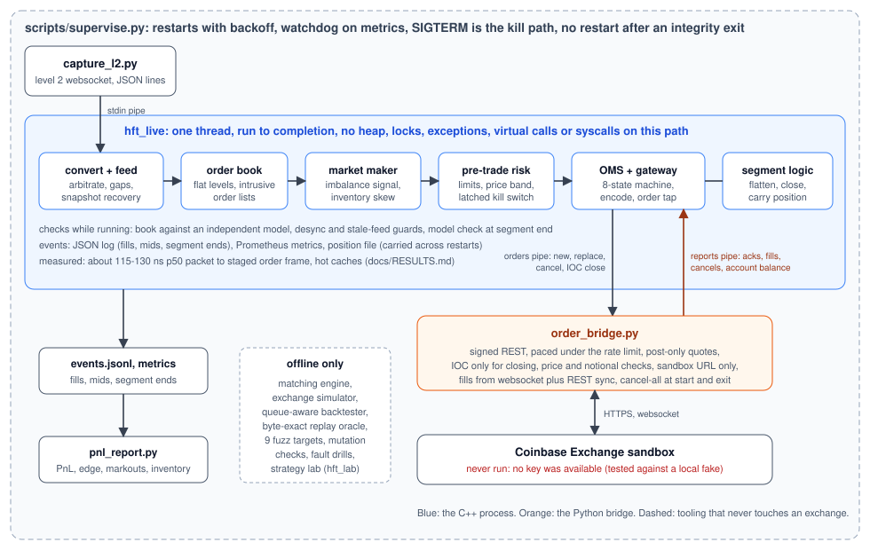

# hft

[](https://github.com/rxj0102/hft/actions/workflows/ci.yml)

A tick-to-trade engine in C++20, built in phase gates with a measurement or a test at every gate. Market data goes in, an order book, a market-making strategy, pre-trade risk, an order management system and an order-entry gateway react in about 115 to 130 ns at the median on a shared VM (hot caches), and around that sit the pieces that make it something you could point at an exchange: a supervisor, a bridge to the Coinbase Exchange sandbox, a closed loop for fills, a position that survives restarts, and a PnL report.

**Honest status:** the C++ pipeline, the replay oracle, the fuzzers and the drills are built and tested. The sandbox bridge and everything that depends on a real exchange (closed loop, closing orders, account check, PnL on real fills) have only run against a local fake exchange written from the public API documentation. No API key was available, so the real sandbox has never been run. [docs/RESULTS.md](docs/RESULTS.md) says exactly what was measured, how, and what was not.



## Numbers

Measured on a shared 2-vCPU Xeon VM at 2.1 GHz, gcc 13.3, one core pinned. Full method, caveats and commands in [docs/RESULTS.md](docs/RESULTS.md).

| | p50 | p99 |
|---|---|---|
| packet bytes in to order frame staged, hot caches | 115 to 127 ns | 213 to 270 ns |
| packet in to decision, no order | 71 ns | 150 ns |
| same, cold L1 and L2 | about 1.0 to 1.1 us | 3.5 to 4.1 us |
| sustained throughput | 15.5 to 16.9 million inputs per second | |

These exclude the NIC, kernel, TLS, JSON parsing and the exchange, and p99.9 and max are mostly noise from the VM. A callgrind instruction-count gate (797.80 instructions per input) runs in CI because wall-clock time on a shared runner is not reliable enough to gate on.

## What is in it

**The hot path** (`include/hft`, header-only): feed handler with A/B line arbitration, gap detection and snapshot recovery; order book with flat price levels and intrusive order lists; market maker with an imbalance signal and inventory skew; pre-trade risk with a latched kill switch; an eight-state OMS; a length-prefixed order-entry protocol. No heap, exceptions, RTTI, virtual calls, locks or syscalls on the path; this is checked by compiler flags, an allocation trap and a page-fault check in the benchmark.

**Around it, offline:** a matching engine and exchange simulator, a queue-aware backtester, and a byte-exact replay oracle: a backtest is recorded and replayed through the production pipeline, and the wire bytes must be identical before the benchmark prints any latency. `hft_lab` runs strategy parameter variants over many generated markets and compares them with paired statistics, can search a parameter grid on training markets and check the winners on held-out ones, can repeat a comparison across seven named market regimes, can sweep latency to show how fast a variant's simulated PnL decays, and can sweep the queue penalty to show how much it depends on the fill model (see [docs/STRATEGY_LAB.md](docs/STRATEGY_LAB.md)); its simulated fills go through the same PnL report that will judge real ones.

**Live, paper:** `hft_live` runs the same pipeline on the live public Coinbase level-2 feed against a paper venue, with guards for a dropped connection, a price off the grid and a silent feed, and it checks its own book against an independent model while running.

**Live, sandbox (mirror and closed loop):** `scripts/order_bridge.py` carries the strategy's orders to the sandbox over signed REST (post-only quotes, rate-limited, price and notional checks, sandbox URL only, keys from environment variables only). With `--loop` the exchange's acks, fills and cancels go back into the OMS, and a segment ends only when the exchange has confirmed the cancels. With `--close-position` a stop closes the position with a reduce-only immediate-or-cancel order and exits 4, loudly, if it cannot. The position and cash are carried across reconnects and, with `--position-file`, across restarts, and a restarted process refuses to trade if the account balance disagrees with the file.

**Operations:** `scripts/supervise.py` restarts with backoff, watches the metrics file, treats SIGTERM as the kill path and does not restart after an integrity verdict. `scripts/drill.py` injects 28 faults and checks the outcome. `scripts/pnl_report.py` turns the event log into PnL, edge against the mid, markouts and inventory.

## How it was checked

- Sanitizers (ASan, UBSan, TSan), gcc and clang, 19 CTest suites, Python test suites for the scripts (capture, live tool, bridge, smoke test, PnL report, strategy lab) plus the drills.
- Nine libFuzzer targets, including one where the fuzz input plays the exchange.
- Mutation checks at every phase: bugs injected on purpose, and a test had to fail. The first runs always had survivors, and each was either killed with a new test or removed as unobservable. Counts are in [docs/RESULTS.md](docs/RESULTS.md) and the changelog.
- GitHub Actions with nine jobs (build and test cells, TSan, fuzz smoke, performance gate). It has found real faults that local runs missed, such as a missing Python package in five cells and a race in a test. See [docs/CI.md](docs/CI.md).
- 44 architecture decision records, including rejected options: [docs/DECISIONS.md](docs/DECISIONS.md).

## Build and run

```
cmake --preset release && cmake --build --preset release
ctest --test-dir build/release --output-on-failure -j2
./build/release/bench/bench_t2t --requests 300000
```

Presets: `release`, `relwithdebinfo`, `perf`, `asan`, `ubsan`, `tsan`, `fuzz`. Needs CMake 3.25 or newer and gcc 13 or clang 18. `test_sim_gate` takes about 4 minutes.

Everything that needs no key runs locally:

```
pip install -r scripts/requirements.txt
scripts/ci_local.sh                 # after the release build: all Python suites and the 28 drills against local fakes
```

Running against the real sandbox (your own key, on a profile used only for this; set it in environment variables and never paste it anywhere):

```
export HFT_CB_KEY=... HFT_CB_SECRET=... HFT_CB_PASSPHRASE=...
python3 scripts/smoke_sandbox.py --report smoke_report.json
```

Without a key, the public part alone can be run: `python3 scripts/smoke_sandbox.py --public-only --report public_report.json` (clock, product, ticker, public level-2 snapshot; no orders, no signed request).

The smoke test places a few minimum-size orders worth under 5 USD and writes a report with no credentials in it. Read [docs/SANDBOX.md](docs/SANDBOX.md) before running the bridge: its cancel-all cancels every open order for the product on the profile.

## Documentation

| | |
|---|---|
| [docs/RESULTS.md](docs/RESULTS.md) | every measured number, with command, machine and caveats |
| [docs/ARCHITECTURE.md](docs/ARCHITECTURE.md) | module map and data flow |
| [docs/DESIGN.md](docs/DESIGN.md) | phase-by-phase design log with measurements |
| [docs/DECISIONS.md](docs/DECISIONS.md) | decision records |
| [docs/LATENCY_BUDGET.md](docs/LATENCY_BUDGET.md) | per-stage budget, method, noise |
| [docs/LIVE_FEED.md](docs/LIVE_FEED.md), [docs/LIVE_PAPER.md](docs/LIVE_PAPER.md) | real data replay and the paper session |
| [docs/SANDBOX.md](docs/SANDBOX.md), [docs/CLOSED_LOOP.md](docs/CLOSED_LOOP.md) | sandbox order entry, closed loop, closing, account check |
| [docs/STRATEGY_LAB.md](docs/STRATEGY_LAB.md) | comparing strategy variants offline, and what that can and cannot say |
| [docs/OPERATIONS.md](docs/OPERATIONS.md), [docs/RUNBOOK.md](docs/RUNBOOK.md), [docs/FAILURE_MODES.md](docs/FAILURE_MODES.md) | running it, what fails and what the engine does |
| [docs/CI.md](docs/CI.md), [CHANGELOG.md](CHANGELOG.md) | the workflow, per-phase changes |

## Limits

- Not run against the real sandbox, so nothing about real fills, latencies, rate limits or the real response formats is known. The first real run will find differences.
- No claim about profitability. The market maker is a mechanism to exercise the engine; the PnL report exists so that a run can be judged, and the strategy lab compares variants only on simulated fills in generated markets.
- Timings are from a shared VM with hypervisor stalls. No bare-metal run, no NIC or kernel-bypass path, one product, one venue.
- Recorded exchange data is not committed. Real-data replay is offline and level 2 only.
- Not built: a FIX parser, AVX2 paths, MSan, multi-instrument operation. Nothing places orders on a production exchange, and the bridge refuses any URL but the sandbox.
- No automatic flatten after a kill unless `--close-position` is on; otherwise that is a human decision (see the runbook).
